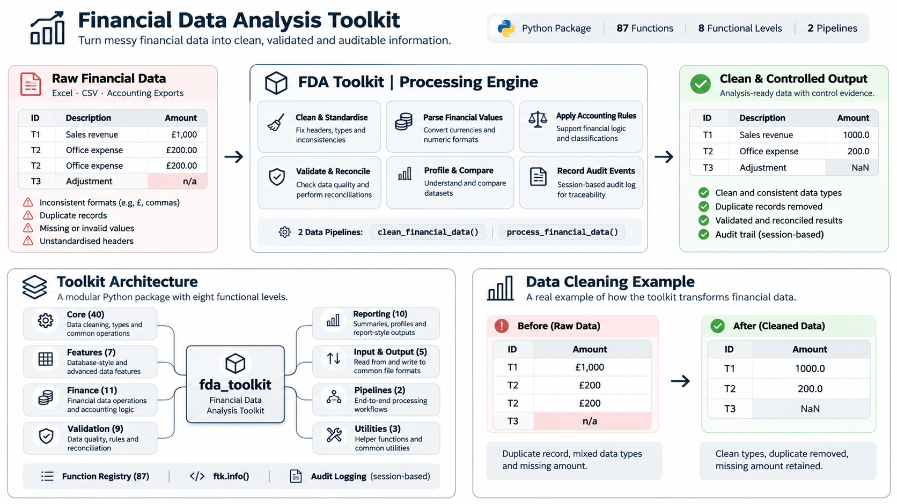
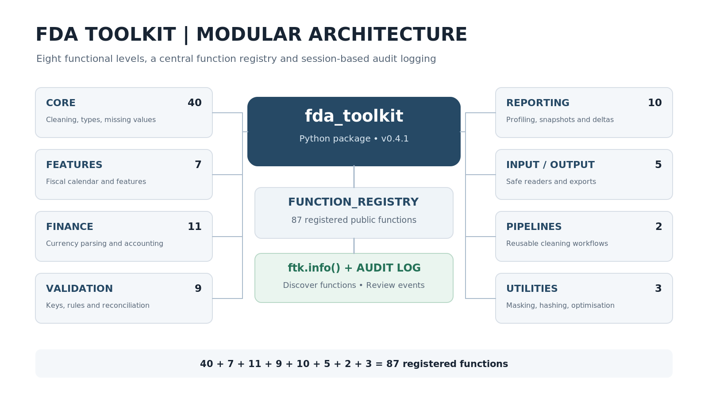

# Financial Data Analysis Toolkit

This project was motivated by the amount of time finance work loses to preparing data rather than analysing it. Exports from accounting systems and published workbooks arrive with inconsistent headers, repeated header rows, subtotal rows, currency symbols embedded in numbers, mixed date formats and duplicated records. I built the Financial Data Analysis Toolkit (package name `fda-toolkit`) to turn the cleaning and validation steps I repeat in financial analytics projects into one documented, tested Python package that records what it has done to the data.

## The design question

> **How can the routine preparation of financial data be made repeatable, checkable and auditable, so that the cleaned dataset can be reconciled back to its source?**

**What the toolkit provides:** 87 registered functions across eight levels, covering column and row cleaning, type conversion, duplicates, outliers, finance specific parsing and rules, validation, profiling, snapshot comparison, safe file input and output, and two ready made cleaning pipelines. Version 0.4.1 is published on the [Python Package Index](https://pypi.org/project/fda-toolkit/).

**How I built it:** Each function is a small, typed operation on a pandas `DataFrame` or `Series` that returns a new object by default. Functions register themselves in a central registry, which is how `info()` produces a live function reference. Most functions also write an event to an in memory audit log so that a cleaning run can be reviewed afterwards.

**Why it matters:** Financial data is only useful if the person using it can show what changed between the source file and the analysis. The reconciliation and snapshot functions exist to answer that question with totals and row counts, not assertion.

**Basis and limitations:** The behaviour described in this document was checked by running the code against pandas 2.3.3 on Python 3.13, with the 16 repository tests passing. Several limitations were found during that check and are listed under [Known limitations](#known-limitations), including a compatibility problem with pandas 3. The package is classified as Beta.

## Package at a glance



The diagram shows the flow from a raw export, through the processing steps, to analysis ready output with an audit trail, and how the eight levels sit around the package. The table gives the size and purpose of each level.

| Level | Functions | Purpose |
| --- | ---: | --- |
| `core` | 40 | Column and row cleaning, type conversion, duplicates, missing values, outliers and text |
| `features` | 7 | Date, fiscal calendar, lag and categorical feature engineering |
| `finance` | 11 | Currency and percentage parsing, entity names, sign conventions and entry balance checks |
| `validation` | 9 | Schema, range, key, referential integrity, time continuity and reconciliation checks |
| `reporting` | 10 | Profiling, missing value and memory reports, snapshots, delta reports and the `info()` reference |
| `input_output` | 5 | Safe reading of comma separated value and Excel files, chunked processing, parquet and report export |
| `pipelines` | 2 | `quick_clean()` and `quick_clean_finance()` |
| `utils` | 3 | Identifier masking, identifier hashing and memory optimisation |
| **Total** | **87** | |

The audit logging helpers (`AuditLog`, `audit_log`, `get_global_audit_log`, `reset_audit_log`) sit in `fda_toolkit.utils.logging` and are not counted in the 87 registered functions.

## Installation

```bash
pip install fda-toolkit
```

To install from source for development:

```bash
git clone https://github.com/CoreInsightFinance/Financial-Data-Analysis-Toolkit-Workspace.git
cd Financial-Data-Analysis-Toolkit-Workspace
pip install -e ".[dev]"
```

| Requirement | Version | Notes |
| --- | --- | --- |
| Python | 3.10 or later | Declared in `pyproject.toml`; classifiers list 3.10, 3.11 and 3.12 |
| pandas | 2.0 or later | Use a 2.x release for now; see [Known limitations](#known-limitations) |
| numpy | 1.24 or later | |
| jinja2 | 3.1 or later | Required for the styled table returned by `info()` |
| pyarrow | Optional | Required only by `export_parquet()` |
| pytest, ruff, mypy | Optional | Installed by the `dev` extra |

To upgrade an existing installation:

```bash
pip install --upgrade fda-toolkit
```

```python
import fda_toolkit as ftk
print(ftk.__version__)  # 0.4.1
```

## Quick start

The example below loads a small set of transactions with typical problems: untidy headers, a duplicated row, a currency symbol, a missing date and a blank amount.

```python
import pandas as pd
import fda_toolkit as ftk

df = pd.DataFrame({
    "Transaction ID": ["T1", "T2", "T2", "T3"],
    "Vendor ": ["Acme Ltd", "ACME LIMITED", "ACME LIMITED", "Beta plc"],
    "Date": ["01/01/2026", "02/01/2026", "02/01/2026", ""],
    "Amount": ["£1,000", "£200", "£200", "n/a"],
})

# One call applies header cleaning, empty value handling, de-duplication,
# currency parsing, date parsing and a primary key check
clean = ftk.quick_clean_finance(
    df,
    primary_key="transaction_id",   # headers are cleaned first, so use the cleaned name
    date_cols=["date"],
    currency_cols=["amount"],
)

ftk.quick_check(clean)              # prints shape, null cells, duplicates and memory use
```

```text
  transaction_id        vendor       date  amount
0             T1      Acme Ltd 2026-01-01  1000.0
1             T2  ACME LIMITED 2026-01-02   200.0
3             T3      Beta plc        NaT     NaN
```

Dates are read day first by default, which suits UK source data. Pass `dayfirst=False` to `clean_date_column()` or `convert_date_columns()` where the source uses month first dates.

To browse the available functions:

```python
ftk.info()                          # every function, ordered by level
ftk.info("finance")                 # one level
ftk.info("level")                   # explicit sort; also "module", "function" or "detail"
ftk.info(module="finance.parsing")  # one module
```

`info()` returns a styled table with the columns `level`, `module`, `function` and `detail`.

## Architecture

### Package layout

```text
src/fda_toolkit/
    __init__.py          Public imports and __version__
    registry.py          register_function decorator and FUNCTION_REGISTRY
    core/                columns, rows, types, missing, duplicates, outliers, text
    features/            categorical, datetime
    finance/             parsing, entities, rules
    validation/          schema, ranges, integrity
    reporting/           profiling, delta
    io/                  readers, writers
    pipelines/           quick_clean
    utils/               logging, security, types
tests/                   test_core_cleaning.py, test_info.py, test_smoke_imports.py
examples/                01_quick_check.py
docs/                    function_reference.md
```

### How functions are discovered

Each public function carries a `@register_function(name=..., category=..., module=...)` decorator. Importing the package populates a global dictionary, `FUNCTION_REGISTRY`, and `info()` reads from it. Adding a function with the decorator is enough for it to appear in the reference table.

```python
from fda_toolkit.registry import register_function

@register_function(name="flag_large_payments", category="Validation", module="custom.payments")
def flag_large_payments(df, threshold=10_000):
    """Return rows where the amount exceeds a threshold."""
    return df[df["amount"] > threshold]
```

Functions can be called from the top level (`ftk.parse_currency`) or from their level (`from fda_toolkit import core`, then `core.drop_empty_rows(df)`).

### Conventions used across the package

- **Copy by default.** Functions that change a `DataFrame` take `copy=True` and return a new object, so the source frame is left untouched.
- **Type hints throughout.** Signatures are annotated and the project configures strict mypy settings.
- **Explicit rules over inference.** Functions that need business judgement, such as `impute_by_rule()`, `validate_sign_conventions()` and `standardize_entity_names()`, take the rule or mapping as an argument rather than guessing.
- **Finance defaults.** The currency parser recognises the pound, dollar, euro and naira symbols, and `create_fiscal_calendar_features()` starts the fiscal year in April.

## Function overview



The table under [Package at a glance](#package-at-a-glance) gives the size of each level. This section describes what each level is for and names a few representative functions. The complete, always current list, with a one line description of every function, is available from `ftk.info()`.

**core.** The foundation for tidying a raw extract. Column functions such as `clean_column_headers()`, `rename_columns()` and `drop_empty_columns()` fix structure. Row functions such as `remove_repeated_headers()`, `remove_summary_rows()` and `filter_by_date_range()` deal with the leftovers of spreadsheet exports. The level also covers type conversion (`convert_date_columns()`), duplicates (`deduplicate_by_priority()`), missing values, outliers and text standardisation.

**features.** Prepares data for modelling and period analysis: date parts, period keys, a fiscal calendar (`create_fiscal_calendar_features()`), lag columns and controls on category counts.

**finance.** Domain logic that general purpose cleaning libraries leave out. It parses currency and percentages, standardises vendor names and reference codes, and applies accounting rules such as sign conventions (`validate_sign_conventions()`) and debit and credit balance checks.

**validation.** Control checks that either raise an error or return the offending rows: required fields, allowed categories, value ranges, primary keys, referential integrity, time continuity and `reconciliation_check()` for totals before and after a transformation.

**reporting.** Describes the data and tracks change: `quick_check()` and `profile_report()` for profiling, `snapshot_dataset()` and `delta_report()` for comparing versions, and `info()` for the function reference itself.

**input_output.** Reads comma separated value and Excel files with existence checks and standard missing value markers, processes large files in chunks, and exports parquet files and JavaScript Object Notation reports.

**pipelines.** `quick_clean()` and `quick_clean_finance()` chain the most common steps into one call. Read [Known limitations](#known-limitations) before relying on their defaults.

**utils.** Masks or hashes sensitive identifiers before data is shared, and reduces memory use by downcasting numeric types.

## Worked patterns

### Controlling a transformation with reconciliation

`reconciliation_check()` compares column totals before and after a step and reports the movement.

```python
before = pd.DataFrame({"amount": [1, 2, 3, 4]})
after = pd.DataFrame({"amount": [1, 2, 3]})

ftk.reconciliation_check(before, after, value_cols=["amount"])
```

```text
   column  before  after  delta
0  amount      10      6     -4
```

Pass `group_cols` to reconcile by vendor, cost centre or period.

### Validating sign conventions

Rules are stated per column. The available rules are `non_negative`, `non_positive`, `positive` and `negative`. The function returns a frame of boolean flags, with `True` marking a breach.

```python
ftk.validate_sign_conventions(
    pd.DataFrame({"revenue": [10, -5]}),
    {"revenue": "non_negative"},
)
```

### Comparing two versions of a dataset

```python
snapshot = ftk.snapshot_dataset(df_before, key_cols=["id"])
delta = ftk.delta_report(df_before, df_after, key_col="id")
# {'total_added': 0, 'total_removed': 1, 'total_changed': 0, 'total_unchanged': 2,
#  'added_keys': [], 'removed_keys': [3], 'changed_keys': []}
```

### Protecting sensitive fields before sharing

```python
safe = ftk.mask_sensitive_fields(df, columns=["iban"])                 # replaced with ***
safe = ftk.anonymize_identifiers(df, columns=["employee_id"], salt="x")  # hashed
```

## Audit trail

Nearly every function calls `audit_log()` when it runs. Events collect in a single global `AuditLog` for the session.

```python
from fda_toolkit.utils.logging import get_global_audit_log, reset_audit_log

log = get_global_audit_log()
len(log)           # number of events recorded
log.to_list()      # [{'name': 'clean_column_headers', 'timestamp_utc': '2026-11-14T16:42:50', ...}]
log.to_dict()      # {'events': [...]}, ready to serialise
reset_audit_log()  # start a clean log
```

The audit trail has these properties, which matter if you intend to rely on it:

- It lives in memory for the current Python session. Nothing is written to disk unless you export it yourself, for example with `export_validation_report()`.
- It is global, so events from separate tasks in the same session share one log. Call `reset_audit_log()` at the start of each run.
- Event details are shortened to the first 100 characters, so the log records that a step ran and a sketch of its result, not a full copy of the data.
- Timestamps are in UTC.

## Testing

```bash
pip install -e ".[dev]"
pytest
```

The suite contains 16 tests in three files: `test_core_cleaning.py` for the cleaning functions, `test_info.py` for the reference table, and `test_smoke_imports.py` for package imports. All 16 pass on pandas 2.3.3. The tests currently emit deprecation warnings from pandas about the `inplace` argument, which do not affect results.

The tests do not yet cover the finance, validation, pipeline or input and output modules. The limitations below were found in code paths the tests do not reach.

## Known limitations

These were found while checking this document against the code. They describe the package as it stands at version 0.4.1.

| Area | Behaviour | Workaround |
| --- | --- | --- |
| pandas 3 | `parse_currency()` rejects pandas 3 string columns because it checks for the `object` dtype. `quick_clean_finance()` fails when `currency_cols` is used. The package declares `pandas>=2.0` with no upper bound, so a fresh installation can pick up pandas 3. | Install `pandas<3` |
| Bracketed currency | `parse_currency()` does not read brackets, so `(200)` becomes a missing value. | Use `clean_accounting_negative()` on that column |
| Accounting negatives | `clean_accounting_negative()` returns a missing value for numbers containing thousands separators, such as `1,000` or `(1,250.50)`, and for values with a currency symbol. | Remove symbols and separators first, or use `clean_numeric_column()` |
| Balanced entries | `check_balanced_entries()` raises an error when `group_cols` is supplied. The row level check works. | Group the data yourself and call the function on each group |
| Primary key in pipeline | `quick_clean_finance()` logs a failed primary key check to the audit log instead of raising, although its docstring says it raises. | Call `assert_primary_key()` directly after the pipeline |
| Encoding detection | `read_csv_safely()` passes `encoding` straight to pandas, so no automatic detection takes place. | Supply `encoding="latin-1"` or similar for non UTF-8 files |
| Zero fill | `quick_clean()` fills every remaining missing value with zero, which is rarely right for financial amounts. | Use the individual functions when zero is not a valid substitute |
| Placeholder functions | `validate_business_rules()` and `exception_report()` raise `NotImplementedError` and are not registered. | None; they are planned |
| Parquet | `export_parquet()` needs pyarrow, which is not installed with the package. | `pip install pyarrow` |

## Documentation and project files

| Resource | Contents |
| --- | --- |
| [Changelog](CHANGELOG.md) | Release history from 0.2.8 to 0.4.1 |
| [Quick reference](QUICK_REFERENCE.md) | Short usage patterns |
| [Examples](examples/) | Example scripts |
| `ftk.info()` | The authoritative, always current function list |

**Source and licence:** The package is released under the MIT Licence, as declared in `pyproject.toml`. Package metadata is in [pyproject.toml](pyproject.toml).

## Author

**Teslim Adeyanju** | [Portfolio](https://adeyanjuteslim.co.uk) | [LinkedIn](https://www.linkedin.com/in/adeyanjuteslimuthman)
